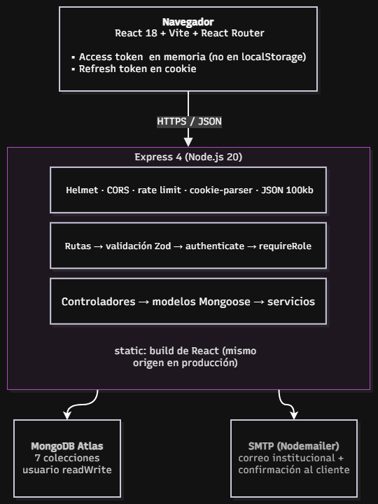
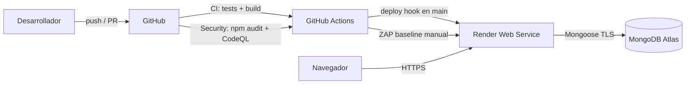
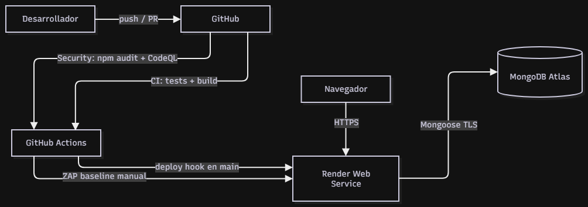

# 01 · Arquitectura y definición del caso

## 1. Organización y problema

**ReservaPro** es un centro de bienestar integral ficticio ubicado en Concepción. Hoy gestiona sus
horas por teléfono y mensajería informal: el cliente no conoce la disponibilidad real, se producen
dobles reservas y el equipo administrativo pierde tiempo coordinando a mano.

La plataforma resuelve tres problemas concretos:

1. **Autoservicio**: el cliente consulta servicios, disponibilidad referencial y reserva en línea.
2. **Centralización**: todas las reservas, mensajes y consultas quedan en una base NoSQL única.
3. **Trazabilidad y seguridad**: cada acción queda asociada a un usuario y rol, con credenciales
   protegidas y evidencia de controles de seguridad.

## 2. Público objetivo

| Perfil | Necesidad |
| --- | --- |
| Visitante | Conocer servicios, precios, ubicación y enviar consultas |
| Cliente registrado | Reservar, revisar y cancelar sus horas |
| Administrador | Gestionar reservas, usuarios, servicios, contenidos y mensajes |

## 3. Alcance

**Incluido**

- Sitio público responsivo (inicio, servicios, contacto).
- Registro e inicio de sesión con JWT y roles.
- Reservas con validación de fecha, cupos y capacidad del servicio.
- Panel administrativo con seis módulos.
- Formulario de contacto con dos correos y registro en MongoDB.
- Chatbot generativo con contexto administrable (FAQ y servicios) y respaldo por reglas.
- Enlaces de redes sociales administrables.
- Pipeline CI/CD y análisis de seguridad.

**Excluido (declarado explícitamente)**

- Pasarela de pagos. No está integrada; el precio se muestra y el pago se coordina presencialmente.
- Recuperación de contraseña por correo (se documenta como trabajo futuro).
- Notificaciones push o por SMS.
- Chatbot con acceso a datos de usuarios o capacidad de ejecutar acciones (el modelo solo recibe
  información pública del negocio y el texto de la conversación).

## 4. Arquitectura

El frontend React se sirve desde el mismo origen que la API, de modo que las cookies de sesión
funcionan sin CORS cruzado. La figura siguiente resume los componentes y el flujo de datos.

### Componentes

| Componente | Responsabilidad |
| --- | --- |
| Frontend SPA | Interfaz, validación de formularios, manejo de sesión y refresh automático |
| API REST | Reglas de negocio, autorización, validación y persistencia |
| MongoDB Atlas | Persistencia NoSQL con usuario de mínimo privilegio |
| Nodemailer | Notificación institucional y confirmación al cliente |
| Asistente generativo | LLM compatible con OpenAI; recibe FAQ y servicios como contexto y usa reglas como respaldo |
| GitHub Actions | CI, SAST, SCA, DAST y CD |
| Render | Hosting HTTPS del servicio único (API + build) |

## 5. Flujo de autenticación

1. `POST /api/auth/register` o `/login` valida los datos y compara el hash bcrypt.
2. El servidor emite un **access token** (15 min) y un **refresh token** (7 días).
3. El access token se devuelve en el cuerpo y el frontend lo mantiene **en memoria**.
4. El refresh token viaja en cookie `httpOnly; Secure; SameSite; path=/api/auth`.
5. En cada petición privada el frontend envía `Authorization: Bearer <access>`.
6. Si el access token expiró, el cliente llama una sola vez a `/refresh`, recibe un nuevo par y
   reintenta la petición original.
7. Cada refresh **rota** el token: en la base solo se guarda el hash SHA-256 del vigente.
8. El logout revoca el hash y limpia la cookie.
9. El middleware vuelve a cargar el usuario desde MongoDB, por lo que desactivar una cuenta invalida
   sus tokens de inmediato.

## 6. Decisiones de diseño y justificación

| Decisión | Alternativa descartada | Motivo |
| --- | --- | --- |
| Servicio único en Render que sirve API + build | Vercel + Render separados | Evita CORS entre dominios y cookies `SameSite=None`; reduce puntos de falla en 7 días |
| Access token en memoria + refresh en cookie | Ambos en `localStorage` | `localStorage` es accesible ante XSS; la cookie `httpOnly` no |
| Refresh token rotativo con hash en BD | JWT de refresh sin estado | Permite revocar sesiones y detectar reutilización |
| bcrypt (12 rondas) | SHA-256 simple | Hash adaptativo, lento por diseño, con sal incorporada |
| Zod en el servidor | Solo validación HTML | La validación del cliente se puede saltar |
| LLM externo con contexto curado | Solo reglas / IA sin contexto | Permite responder preguntas generales sin inventar datos del negocio; menor costo y latencia que un modelo propio, con respaldo por reglas si el proveedor falla |
| Mongoose `sanitizeFilter` | Confiar en el tipado | Bloquea operadores como `$ne` inyectados |
| Baja lógica de servicios | Borrado físico | Conserva la integridad del historial de reservas |

## 7. Requisitos no funcionales

| Atributo | Implementación |
| --- | --- |
| Seguridad | JWT + bcrypt + RBAC + Helmet + CORS + rate limit + validación |
| Disponibilidad | Render con health check `/api/health`; reinicio automático |
| Rendimiento | Índices en las consultas frecuentes; límite de 100 kb por cuerpo |
| Mantenibilidad | Separación por capas y modelos; variables de entorno |
| Observabilidad | Logs de peticiones y errores sin datos sensibles |
| Tolerancia a fallos | Si el proveedor LLM falla o no hay clave, el chatbot responde con el motor de reglas |
| Usabilidad | Diseño responsivo y mensajes de error claros |

## 8. Modelo de despliegue

Render ejecuta `npm ci` del backend y frontend, compila Vite y arranca Express. Express sirve el
build estático y la API desde el mismo origen. Las variables sensibles se configuran en el panel de
Render y nunca se versionan.
