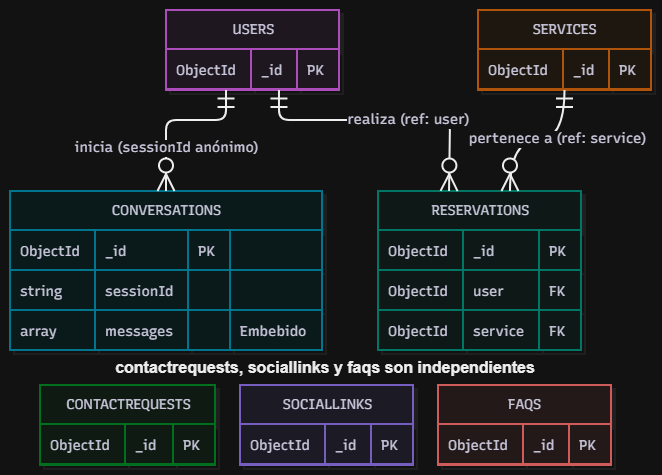

# 02 · Modelo de datos NoSQL

Base de datos: **MongoDB Atlas**, base `reservas`. Acceso mediante Mongoose 8 con
`sanitizeFilter` activo y validaciones a nivel de esquema.

## 1. Colecciones

### `users`

| Campo | Tipo | Restricciones |
| --- | --- | --- |
| `_id` | ObjectId | PK |
| `name` | String | requerido, máx. 80 |
| `email` | String | requerido, único, minúsculas, formato válido, máx. 120 |
| `passwordHash` | String | requerido, `select: false` |
| `role` | String | enum `admin` / `client`, por defecto `client` |
| `active` | Boolean | por defecto `true` |
| `refreshTokenHash` | String | `select: false`, SHA-256 del refresh vigente |
| `refreshTokenExpires` | Date | `select: false` |
| `lastLoginAt` | Date | auditoría |
| `createdAt` / `updatedAt` | Date | timestamps automáticos |

Índices: `email` (único), `{ role, active }`.

### `services`

| Campo | Tipo | Restricciones |
| --- | --- | --- |
| `name` | String | requerido, máx. 80 |
| `description` | String | requerido, máx. 500 |
| `durationMin` | Number | 15–480 |
| `price` | Number | 0–1.000.000 |
| `capacity` | Number | 1–100 (cupos por horario) |
| `active` | Boolean | por defecto `true` (baja lógica) |
| `order` | Number | orden de presentación |

Índices: `{ active, order }`, `{ name }`.

### `reservations`

| Campo | Tipo | Restricciones |
| --- | --- | --- |
| `user` | ObjectId → `users` | requerido, referenciado |
| `service` | ObjectId → `services` | requerido, referenciado |
| `startAt` | Date | requerido, futuro |
| `partySize` | Number | 1–20 |
| `contactPhone` | String | máx. 30 |
| `notes` | String | máx. 500 |
| `status` | String | `pending`, `confirmed`, `cancelled`, `completed` |

Índices: `{ user, startAt: -1 }`, `{ service, startAt, status }`, `{ startAt }`, `{ status }`.

### `contactrequests`

| Campo | Tipo | Restricciones |
| --- | --- | --- |
| `name` | String | requerido, sin saltos de línea, máx. 80 |
| `email` | String | requerido, válido, minúsculas, máx. 120 |
| `phone` | String | opcional, máx. 30 |
| `subject` | String | requerido, sin saltos de línea, 3–120 |
| `message` | String | requerido, 10–2000 |
| `status` | String | `new`, `in_progress`, `answered`, `closed` |
| `emailStatus` | String | `sent`, `skipped`, `failed` (auditoría interna) |

Índices: `{ status }`, `{ createdAt: -1 }`.

### `sociallinks`

| Campo | Tipo | Restricciones |
| --- | --- | --- |
| `network` | String | requerido, máx. 40 |
| `url` | String | requerido, URL válida, máx. 300 |
| `active` | Boolean | por defecto `true` |
| `order` | Number | orden de presentación |

Índice: `{ active, order }`.

### `faqs`

| Campo | Tipo | Restricciones |
| --- | --- | --- |
| `question` | String | requerido, máx. 200 |
| `answer` | String | requerido, máx. 1000 |
| `category` | String | máx. 60 |
| `keywords` | [String] | máximo 20 elementos |
| `active` | Boolean | por defecto `true` |
| `order` | Number | orden |

Índice: `{ active, category, order }`.

### `conversations`

| Campo | Tipo | Restricciones |
| --- | --- | --- |
| `sessionId` | String | requerido, único, generado en el navegador |
| `messages` | Array embebido | `{ role: bot/user, text, source: llm/rules/fallback, at }` |
| `lastActivityAt` | Date | índice para limpieza |

Índices: `sessionId` (único), `lastActivityAt`. Los mensajes se limitan a los últimos 40 por sesión.

## 2. Relaciones

Se usa **referencia** para entidades que crecen de forma independiente (`user`, `service` en
`reservations`) y **embebido** para datos que siempre se consultan juntos (mensajes dentro de una
conversación). Esto evita duplicar información del servicio y permite actualizar precios sin reescribir
el historial.

```
users 1 ──── N reservations N ──── 1 services
users 1 ──── N conversations (por sessionId anónimo, sin dato personal)
contactrequests, sociallinks y faqs son independientes
```



## 3. Validación e integridad

- Tipos, rangos, longitud y enums definidos en los esquemas Mongoose (`runValidators: true` en
  actualizaciones).
- Zod valida el cuerpo antes de llegar al controlador.
- `mongoose.set('sanitizeFilter', true)` impide inyección de operadores en filtros.
- `capacity` se verifica contra las reservas activas de la misma franja antes de insertar.
- `email` único a nivel de índice.

## 4. Usuario de base de datos con mínimo privilegio

La aplicación **no** usa la cuenta administrativa de Atlas.

En Atlas: **Database Access → Add New Database User**

- Username: `reservas_app`
- Password: generada y guardada en el gestor de secretos / variable de entorno
- Built-in Role: rol personalizado `readWrite` sobre la base `reservas`

Equivalente en `mongosh`:

```javascript
use reservas
db.createUser({
  user: "reservas_app",
  pwd: passwordPrompt(),
  roles: [{ role: "readWrite", db: "reservas" }]
})
```

Verificación:

```javascript
db.getUser("reservas_app")
// roles: [ { role: "readWrite", db: "reservas" } ]
```

La cadena de conexión queda en `MONGODB_URI` y nunca en el repositorio.

## 5. Índices y consultas demostrables

```javascript
// Uso de índices en consultas frecuentes
db.reservations.find({ user: ObjectId("...") }).sort({ startAt: -1 }).explain("executionStats")
db.reservations.find({ service: ObjectId("..."), startAt: ISODate("..."), status: { $in: ["pending","confirmed"] } })
db.users.find({ email: "cliente@correo.cl" })
db.faqs.find({ active: true }).sort({ order: 1 })
```

Verificar con `db.<coleccion>.getIndexes()`.

## 6. Respaldo y recuperación

**Opción A — mongodump / mongorestore** (recomendada para evidencia):

```bash
mongodump --uri="$MONGODB_URI" --out=backup/2026-11-11
mongorestore --uri="$MONGODB_URI" --drop backup/2026-11-11
```

**Opción B — Atlas UI**: Cluster → Collections → Export collection (JSON/CSV). Para respaldo
completo, Database Deployments → Backup (según plan contratado; en M0 usar export manual).

**Procedimiento documentado**

1. Ejecutar el respaldo antes de cambios de esquema o datos masivos.
2. Verificar el archivo generado (`backup/.../reservas/*.bson`) y su tamaño.
3. Registrar fecha, responsable y cantidad de documentos.
4. Para restaurar: probar primero en una base `reservas_restore` y luego en producción.
5. Validar integridad consultando conteos por colección.

## 7. Documento de ejemplo

```json
{
  "_id": "6712a1f0c9d8e4b1a2c3d4e5",
  "user": "6712a0aac9d8e4b1a2c3d4e1",
  "service": "67129f10c9d8e4b1a2c3d4d1",
  "startAt": "2026-11-20T14:00:00.000Z",
  "partySize": 2,
  "contactPhone": "+56912345678",
  "notes": "Primera sesion",
  "status": "pending",
  "createdAt": "2026-11-11T10:15:00.000Z",
  "updatedAt": "2026-11-11T10:15:00.000Z"
}
```
